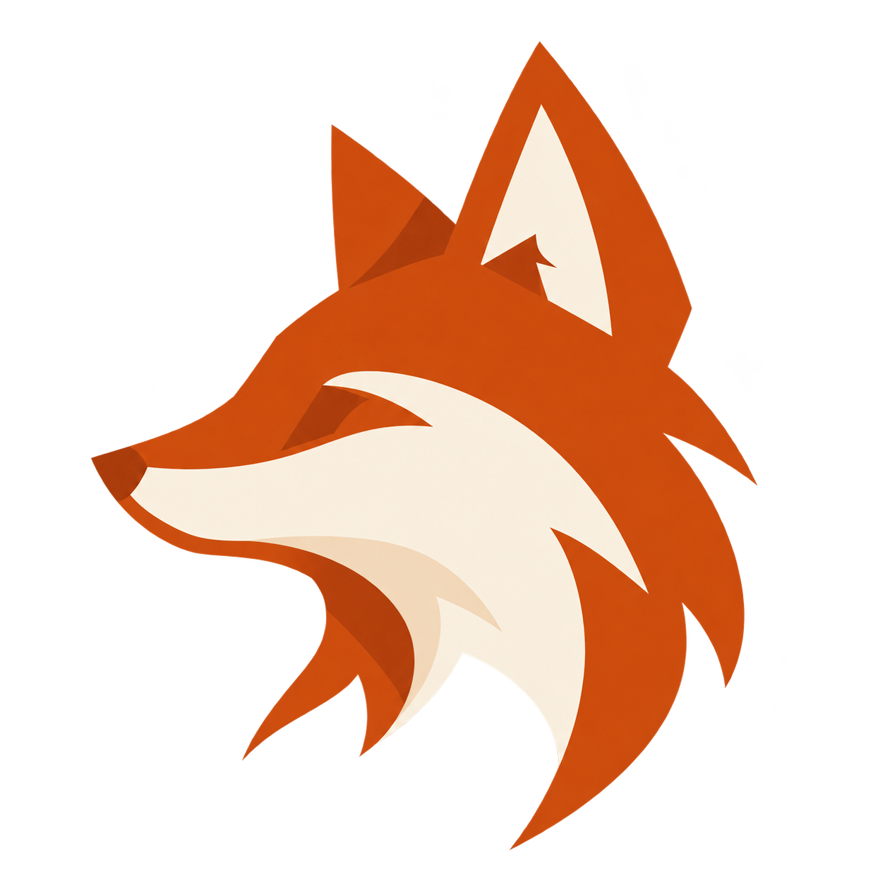

# Jonathan Maquenhem

### Développeur Full Stack · Symfony & Vue.js

**Applications métier · DevOps · Cloud**

Comprendre les usages, construire des solutions utiles et les faire évoluer dans le temps.

[LinkedIn](https://www.linkedin.com/in/jonathan-maquenhem/) · [Me contacter](mailto:maquenhem.jonathan.emploi@gmail.com)

**Disponible pour de nouvelles opportunités · Lyon & Ain**

---

## Ce qui m’anime

J’aime partir d’un besoin concret, comprendre les contraintes et trouver une réponse adaptée aux personnes qui utiliseront le résultat. Le développement m’intéresse dans son ensemble : l’interface, la logique applicative et les environnements qui permettent de la mettre à disposition.

**Curieux, autonome et polyvalent**, j’apprends en explorant et en construisant. J’aime prendre un sujet en main, chercher des solutions et échanger pour les faire avancer.

Mes **trois années d’alternance chez Orange**, de 2023 à 2026, m’ont permis de relier ces dimensions sur une application métier : développement Symfony et Vue.js, intégration continue, environnements Cloud Foundry et participation à la mise en production.

## Mon portfolio

Mon portfolio rassemble **mon parcours, mes réalisations et ce que j’y ai apporté**. J’y présente aussi bien mon expérience en entreprise que mes projets associatifs, indépendants et collectifs, avec leur contexte et les choix réalisés.

Je l’ai conçu autour d’une identité qui me ressemble : un renard, des ambiances saisonnières et un parcours inspiré de Git. Le site est développé avec **Astro, TypeScript et Tailwind CSS**, et déployé sur **Vercel**.

**[Explorer le portfolio →](https://jonathan-mqhm.vercel.app/)**

## Mes compétences

| Domaine | Technologies |
| --- | --- |
| Backend | PHP · Symfony · API · MariaDB · SQL |
| Frontend | Vue.js · JavaScript · HTML · CSS |
| DevOps & Cloud | Cloud Foundry · GitLab CI/CD · Docker · Terraform · Prometheus |

## Quelques réalisations

### [AMTTA · Association Mions Tir à l’Arc](https://amtta-mions.fr)

Un site associatif que je fais évoluer depuis 2022, au rythme des besoins du club : organisation des informations, navigation, contenus et accès au contact. Une expérience de conception web et de suivi dans la durée.

**Wix · Conception web · Contenu · UX**

### Cabinet d’ostéopathie · Site vitrine

Un projet pour deux praticiennes, de la structure des pages à l’intégration : identité visuelle, présentation du cabinet et informations utiles aux patients, avec une attention portée à la clarté et à l’affichage mobile.

**WordPress · Gutenberg · HTML · CSS**

[Voir l’aperçu provisoire dans le portfolio →](https://jonathan-mqhm.vercel.app/#projets)

### [Portfolio personnel](https://jonathan-mqhm.vercel.app/)

Un projet qui relie conception visuelle et développement : présentation des réalisations, galeries, parcours chronologique et préférences d’affichage, dans un site généré statiquement.

**Astro · TypeScript · Tailwind CSS · Vercel**

---

<code>git commit -m "curieux & autonome"</code>

[Portfolio](https://jonathan-mqhm.vercel.app/) · [LinkedIn](https://www.linkedin.com/in/jonathan-maquenhem/) · [Email](mailto:maquenhem.jonathan.emploi@gmail.com)

